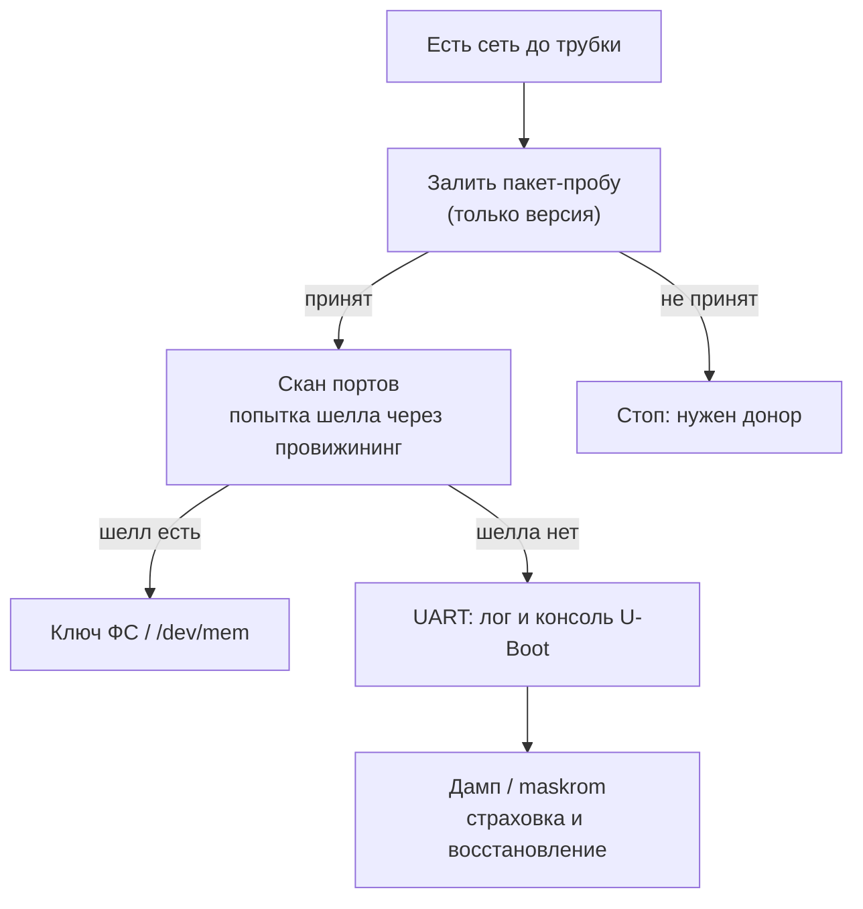

# Что чем решается

Короткая карта: какой способ доступа что даёт и в каком порядке идти. Здесь же ответ на вопрос «нужен ли UART и дамп, если есть сеть».

## Матрица: что даёт каждый способ

| Способ | Залить пакет | Лог загрузки | Ключ ФС | Восстановление после кирпича |
|---|---|---|---|---|
| Сеть (веб-интерфейс) | да | нет | нет | нет |
| Шелл через провижининг **[гипотеза]** | да | частично | возможно | нет |
| UART (3 провода) | нет | да | нет | нет |
| Дамп / maskrom | нет | — | да | да |

## Порядок и гейты

1. **Сеть: залить пакет-пробу.** Гейт: пакет принят → идём дальше; не принят → стоп, нужен донор.
2. **Сеть: скан портов и попытка шелла.** Гейт: шелл есть → читаем ключ, UART не нужен.
3. **UART.** Если шелла нет: лог загрузки и консоль U-Boot. Гейт: консоль отвечает → дамп командами без паяльника.
4. **Дамп / maskrom.** Когда нужен ключ ФС или восстановление после неудачной записи.

## Ответ коротко

- Для проверки приёма пакета — **сети достаточно**, UART и дамп не нужны.
- Для своих файлов в ФС — **нужен ключ**, а его сеть не отдаёт.
- Дамп — это ещё и страховка: если запись сорвётся, без него трубку не поднять.

Связанное: [Прошивка по сети](network.html) · [USB и maskrom](usb.html) · [Ветки](branches.html) · [Порядок работ](plan.html).
