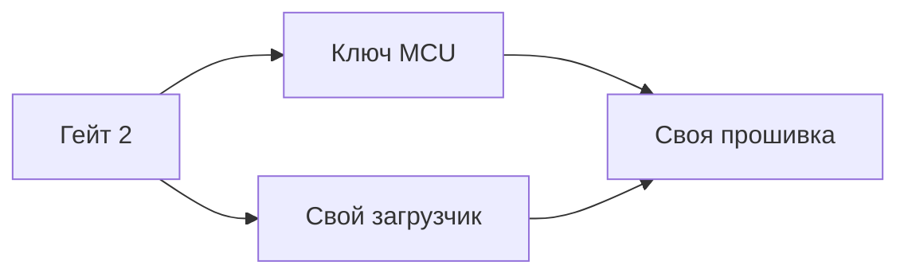

# Что чем решается

Цель одна: **на трубке работает наша прошивка**, которую мы сами правим и дополняем.

<ol class="gates">
  <li class="done">1Трубка принимает наш пакетоткрыт</li>
  <li class="now">2Файловая система читается и пишетсязакрыт</li>
</ol>

Оба пути ведут к одной цели и различаются только тем, что даёт доступ: ключ или свой загрузчик.

## Что реально ведёт к результату

| Путь | Что он даёт | Что для него нужно | Статус |
|---|---|---|---|
| **1. Ключ ФС** — снять с шины SoC ↔ MCU | штатный том расшифровывается, правим и пишем свои файлы | анализатор и 3–4 щупа на плате ([куда цепляться](usb.html#mcu)) | не начато |
| **2. Свой загрузчик** — убрать `ubifs crypto` | ФС без шифрования: любые файлы, любой формат | консоль U-Boot, дамп или maskrom | не начато |
| **3. Свой `version.elf`** — наш апдейтер пишет `rfs` | заливка без вендорского формата | имеет смысл только вместе с путём 2 | **[гипотеза]** |

Пути 1 и 2 — альтернативы: либо ключ к существующему тому, либо свой загрузчик вместо штатного. Путь 3 не самостоятельный — он лишь упрощает запись.

## Что не ведёт к результату само по себе

| Способ | Чего не хватает |
|---|---|
| Веб-интерфейс / сеть | только заливка пакета; ФС остаётся зашифрованной |
| UART без консоли | видно лог, но нечего править |
| Дамп без ключа | шифротекст; читается только после замены загрузчика |
| Свой пакет со своими файлами | трубка его примет, но при загрузке ФС не прочитает |

## Порядок

1. **UART** — самый дешёвый вход: консоль загрузчика, лог, возможность выгрузки. **[гипотеза]** выгрузка NAND по сети из U-Boot — зависит от сборки, у нас её ещё не проверили; если нет, останется медленный слив через последовательный порт.
2. **Сниффинг шины MCU** — если консоль не даёт записи, ключ решает задачу напрямую.
3. **Дамп / maskrom** — страховка и восстановление, а также вход для пути 2.

Связанное: [Ветки](branches.html) · [Как делали другие](sources.html) · [USB и maskrom](usb.html) · [Порядок работ](plan.html).
