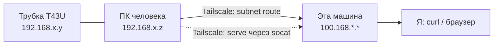

# Удалённый доступ к трубке

Трубка Tailscale не умеет — в tailnet входит **ПК рядом с ней**, и уже через него я достаю трубку.

## Вариант A — подсетевой маршрут

Доступ ко всей его сети, трубка по обычному IP.

- Он: `tailscale up --advertise-routes=192.168.x.0/24`
- Владелец tailnet: Approve маршрута в админке
- Здесь: уже `RouteAll: true`, ничего делать не нужно
- Проверка: `ping 192.168.x.y` → `curl -I http://192.168.x.y`

## Вариант B — только веб-интерфейс

Уже, но безопаснее: виден один порт трубки.

- Он: `socat TCP-LISTEN:8080,fork TCP:192.168.x.y:80`
- Он: `tailscale serve --bg http://127.0.0.1:8080`
- Я: открываю `https://<узел>.ts.net`
- **`funnel` нельзя** — это публичный интернет

## Чего не делать

- Не давать чужому человеку свой аккаунт Tailscale — достаточно **Share node**.
- Не выставлять веб-интерфейс трубки в интернет.
- Сменить пароль `admin` до любого проброса.
- Auto Provision и RPS — выключены.
