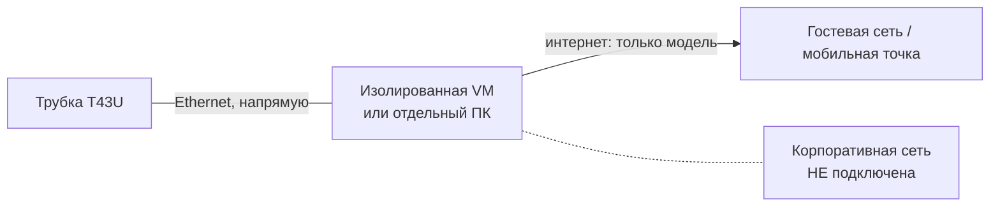

# Безопасность: как давать доступ агенту

Принцип простой: **доступ агента = ровно то, что видит машина, на которой он запущен**. Поэтому ограничивать надо машину, а не обещания.

## Правильный воркфлоу

1. **Отдельная машина или VM.** VM лучше: снапшот до работы, откат после — это проверяемо, а не «на слово».
2. **Вне корпоративной сети.** Wi-Fi выключен, кабель корпоративной сети не воткнут. Интернет — гостевая сеть или мобильная точка (агенту нужен интернет).
3. **Никаких корпоративных следов на машине:** учёток, VPN, сетевых дисков, почты, сохранённых паролей в браузере.
4. **Трубка — напрямую в эту машину** по Ethernet. Никаких маршрутов в корпоративную подсеть.
5. **Tailscale:** отдельный узел, без `advertise-routes`, без exit node. Доступ шарится точечно (`Share node`), не аккаунтом.
6. **Пароль `admin` на трубке сменить** до начала. Auto Provision и RPS выключить.
7. **Работаем.** Я обращаюсь только к IP трубки; всё, что вне этого, согласуется отдельно.
8. **После работы:** отозвать share и ключи, снапшот откатить (VM) либо сверить состояние машины (см. ниже).
9. **Проверка машины:** полное сканирование антивирусом/EDR, проверка автозапуска, служб, задач и сетевых соединений.

## Что проверять после сессии (VM — откат, железо — проверка)

- новые файлы и процессы: автозапуск, планировщик, службы;
- исходящие соединения, которых раньше не было;
- изменённые файлы в `%APPDATA%`, `%PROGRAMDATA%`, профиле пользователя;
- журнал Tailscale (кто и когда подключался);
- полное сканирование AV/EDR;
- ротация паролей, которые были доступны на этой машине.

## Что реально ограничивает

- **VM со снапшотом** — сильнее всего: после работы состояние возвращается к исходному.
- **Отдельный пользователь ОС** без прав администратора — меньше поверхности.
- **Изоляция сети** — единственное, что мешает «пойти дальше» трубки.
- **Транскрипт сессии** — все мои команды видны в логе; его можно сохранить и приложить к проверке.

## Чего делать нельзя

- Давать доступ с машины, где есть корпоративная почта, VPN и сетевые диски.
- Включать subnet route в корпоративную подсеть.
- Оставлять `admin`/`admin` на трубке и пробрасывать её интерфейс в интернет.
- Полагаться на «он обещал не трогать» вместо изоляции.
